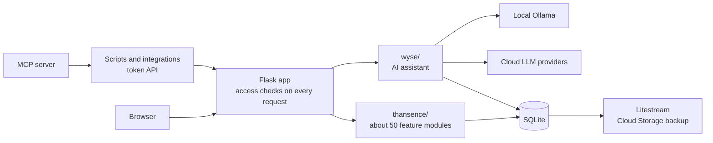

# ThanSence

**A back office for UK small businesses, with a built-in AI assistant that works from the store's own figures.**

ThanSence started as a tool for fuel stations and convenience stores. It now covers shops, cafés, wholesalers, warehouses, hotels, schools, clinics and consultancies. Staff enter or upload the day's figures, managers check and lock them, and admins see every store side by side. On top of that sits **Wyse**, an AI assistant that answers questions from the store's data and does routine jobs once a person confirms them.

> Screenshot or short demo GIF here (Dashboard + a Wyse chat works best)

---

## What it does

| Area | Highlights |
|---|---|
| **Daily figures** | Daily sheet typed in or read from till report PDFs, till reconciliation, a two-step submit and commit lock, weekly, monthly and yearly reports |
| **Sales analysis** | KPIs in each business's own words, period comparison, product performance (ABC, GMROI), store benchmarking, targets with a catch-up plan |
| **Planning** | Demand forecasting with five back-tested models, weather effects learnt per store, supply planning and draft orders, S&OP with scenarios and budgets |
| **Operations** | Stock and orders, invoices with VAT, supplier invoice import, incidents and maintenance, shifts, payslips and pensions |
| **Admin and security** | Role-based access, two-step sign-in, Google and Microsoft sign-in, audit log, GDPR data export and erasure |

Each business picks its type, and that choice changes the sections, the fields and even the words on screen. A hotel sees "Revenue" and "Guests". A café sees "Orders" and "Covers".

---

## Wyse, the AI assistant

Wyse is where most of the interesting engineering is.

- **Seven model providers behind one interface.** Claude, ChatGPT, Gemini, Grok, DeepSeek, Mistral or a local Ollama model. Keys stay on the server.
- **Private data stays local.** In hybrid mode, questions about pay and personal details go to the local Ollama model and are never sent to a cloud API, even if the local model fails.
- **Actions only after you confirm.** Wyse can fill in a sheet, log a shift, add a task or report a fault. Every plan expires after 30 minutes, runs once, and goes through the same route and access checks as the signed-in person.
- **Guardrails.** For page control, the page lists what can be clicked, the model picks only from that list, and the server checks every step. Save, commit, delete and send are never offered. Instructions hidden inside uploaded files are ignored.
- **MCP server.** 22 tools over the token API, so Claude Desktop or Claude Code can work with a store's data. Agent mode makes a short-lived token per run, pauses before every write, and revokes the token when the run stops.
- **Multi-agent runs.** Router, supervisor and hierarchy patterns, capped at 14 model calls and streamed as they run.
- **Cost control.** Every reply's tokens and cost are metered against a monthly budget, with an optional hard stop.
- **Evaluation.** `tools/wyse_eval.py` runs everyday instructions, and ones Wyse must refuse, against a copy of the database. It runs after any change to a skill.
- **Wyse ML.** A small neural network written in NumPy for 7-day forecasts. It is only used when it beats a plain weekday forecast on held-back days.

---

## How it fits together



- Every feature is a Flask blueprint built from `create_blueprint(core)`, so modules share helpers without circular imports.
- Wyse reaches the platform only through `wyse/context.py`, which keeps the AI code easy to swap and test.
- All access rules run in one `before_request` hook: tokens, session checks, role and area access, and a store fence so people only see their own store.

---

## Tech stack

**Backend:** Python 3.12, Flask 3, SQLite, gunicorn
**AI:** Anthropic SDK, plain HTTP for the other providers and Ollama, MCP, NumPy
**Front end:** server-rendered HTML and plain JavaScript, one script per page
**Delivery:** Docker, Google Cloud Run, Litestream, Secret Manager, GitHub Actions
**Quality:** pytest, ruff

The requirements file is short on purpose: `flask`, `anthropic`, `pypdf`, `mcp`, `numpy`. Everything else uses the standard library.

---

## Run it locally

```bash
python -m venv .venv
source .venv/bin/activate          # Windows: .venv\Scripts\activate
pip install -r requirements.txt
python app.py                      # http://127.0.0.1:5000
```

Load demo data so every page has something to show:

```bash
python tools/add_demo_businesses.py data/thanent.db   # one demo business of every type, 120 days each
python tools/add_test_users.py data/thanent.db        # test people for every role
```

Set `THANSENCE_INITIAL_PASSWORD` before the first start so no default passwords are left in place. Add an `ANTHROPIC_API_KEY` or point `OLLAMA_HOST` at a local model to turn on Wyse.

## Connect it to Claude Code

```bash
claude mcp add thansence --env THANSENCE_TOKEN=ths_... --env THANSENCE_URL=http://127.0.0.1:5000 -- python /path/to/mcp_server.py
```

## Tests

```bash
pip install -r requirements-dev.txt
python -m pytest tests
```

Tests use a fresh, empty database each run and fake every outside service, so they need no keys and cost nothing.

---

## Deployment

```
pull request ──► CI (lint, tests, container build)
push to main ──► CI ──► build image ──► Sandbox (private, demo data)
tag v1.2.3   ──► CI ──► same image  ──► reviewer approves ──► Production
```

It runs on Google Cloud Run. Litestream copies every database change to Cloud Storage within about a second and restores it on start-up. Secrets come from Secret Manager, and Workload Identity Federation means no service account keys are stored. Full steps are in `deploy/README.md`.

## Known limits

- SQLite with one Cloud Run instance suits a group of stores. Heavy growth would mean moving to Postgres, and `get_db_connection()` is the one place to start.
- Payslips expect tax and NI figures from payroll software. They are not calculated here.
- An abrupt stop on Cloud Run can lose the last second or so of writes.

---

Built by **Thanigai Singaravelan** · [LinkedIn](https://linkedin.com/in/than-tsv) · [GitHub](https://github.com/ThanigaiSingaravelan)
